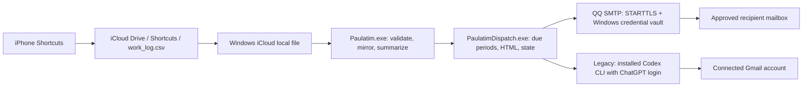

# Paulatim

Track actual and effective time on an iPhone, synchronize through iCloud, and receive daily and weekly reports from a Windows computer.

Paulatim began as an IELTS study log. Its next input upgrade will support IELTS, Projects, Academic, and Career while preserving existing records. **The current reader still accepts the original four-column CSV. Category support is being designed and is not implemented.**

The repository and development folder are named **Paulatim**. The programs are `Paulatim.exe` and `PaulatimDispatch.exe`; new installations use the tasks `Paulatim-iCloud-to-D` and `PaulatimMail-Dispatch`. Existing installations are not automatically moved or reconfigured by a source rename. See the [rename and migration notes](docs/RENAME-2026-10-12.md).

## Status

| Capability | Current status |
| --- | --- |
| Validate and mirror a local iCloud CSV while preserving its original bytes | Implemented |
| Actual/effective minutes, task totals, daily totals, effective percentage | Implemented |
| Daily/weekly HTML reports with a complete CSV snapshot and attachment | Implemented |
| Strict source readiness before report submission (PAU-001) | Implemented, tested offline and deployed to the formal Windows controller on 2026-10-14; requires stable observation plus owner confirmation bound to source SHA-256 and closed report dates |
| 08:00 Beijing scheduling and catch-up after Windows login | Implemented; late-login logic tested with a simulated clock |
| Independent QQ sender through native SMTP, without a model call | Implemented; Windows credential vault, STARTTLS, persistent delivery ledger; see [sender migration](docs/MAIL_SENDER_MIGRATION.md) |
| This computer's formal daily/weekly QQ-to-Gmail route | Migrated on 2026-10-12; existing task triggers and receipts preserved; post-cutover controller idle |
| Long-term data foundation | Separate development CLI implemented: permanent IDs, raw archives, DS1/DS2 migration, validated generations and rollback; not deployed |
| Email through the installed Codex CLI and an existing Gmail connection | Legacy option; depends on account access, quota, network, and CLI compatibility |
| Locks, receipt state, retry limits, timeout, child-process cleanup | Implemented with known reliability gaps; see validation below |
| Category + Task input: IELTS / Projects / Academic / Career | Design in progress; no parser or iPhone shortcut upgrade deployed |
| SMTP acceptance and crash-safe recovery | Implemented for QQ; acceptance does not prove inbox delivery, ambiguous outcomes require review |
| Independent Gmail receipts for the legacy route, health reporting, Windows CI | Planned |
| macOS support or delivery while the Windows computer is off | Planned; unavailable in the current implementation |

## Architecture



- **Synchronization:** `Paulatim.cs` reads the source without modifying it, validates records, and writes `work_log.csv`, `report-data.json`, and `sync-status.json` beside its executable. A file lock, SHA-256 comparisons, atomic replacement, and a previous CSV mirror protect local updates. Invalid sources do not replace the last valid mirror.
- **Reporting:** `PaulatimDispatch.cs` selects due periods, reruns synchronization, and checks hashes across the source, mirror, status, and raw snapshot. It builds HTML and a CSV attachment locally. The explicitly selected transport sends through QQ SMTP or the legacy Codex/Gmail worker. A failed source refresh blocks sending the old mirror as a fresh snapshot. New subjects use Paulatim; confirmed WorkLog receipts remain valid.
- **Scheduling:** Windows Task Scheduler starts native Windows-subsystem executables directly without opening a terminal. Login and minute-level checks handle catch-up and retry. No due report means no model process. Tasks use the signed-in user's interactive session; they do not run before login.
- **State:** Local receipt keys identify daily and weekly periods. Damaged state is rejected rather than cleared automatically. The QQ route durably records an intent before sending, freezes its original payload, and records SMTP acceptance afterward. An interrupted or ambiguous send blocks automatic resending. Its deterministic client Message-ID identifies local intent; QQ rewrote that header in the real verification, so recipient reconciliation must use observed IDs and inspect the report. It is not a server-side deduplication guarantee. The legacy worker's structured Gmail result is still trusted by its controller.

There is no paid model API integration or API-key requirement. QQ sending uses no model, Codex quota, or Gmail send permission. Reading reports from a ChatGPT chat still requires that chat's authorized mailbox capability. The legacy sender uses an existing ChatGPT login and Gmail connection. This version has no database, hosted backend, `.csproj`, or NuGet dependency.

## Current CSV contract

UTF-8 records have **exactly four fields**, in this order:

```csv
timestamp,task,actual_minutes,effective_minutes
2030-01-01 09:00,"IELTS listening, practice",30,20
2030-01-01 10:00,Example task,45,40
```

These examples are fictional. A header is optional: the first row of a headerless file is a record. Recognized headers use `timestamp` or `datetime` with the other names shown above, or the Chinese headers in the [existing guide](Paulatim/README.md).

- Timestamps use `yyyy-MM-dd HH:mm`, `yyyy-MM-dd HH:mm:ss`, or the corresponding `T` separator formats. They are interpreted as Beijing local time and have no timezone offset.
- `task` must contain text. CSV quoting supports commas, quotes, and embedded newlines.
- Actual/effective time is measured in **minutes**, including nonnegative decimals with a decimal point. Effective percentage is `effective / actual × 100`, rounded to one decimal place; zero actual time produces no percentage.
- Duplicate rows, future dates, and effective time greater than actual time produce warnings and are retained, without silent correction or deduplication.
- The default source limit is 16 MiB. Empty, malformed, or oversized sources fail validation.

**Do not append Category with the current reader.** Five-column or mixed four/five-column input fails validation and can delay reports. The input upgrade requires a compatible reader and validation before changing the iPhone shortcut.

See the [proposed Shortcuts migration](docs/SHORTCUTS_MIGRATION.md) for compatibility rules, current-format probes, and the iPhone steps that require manual action. It is a proposal awaiting approval, not a deployed feature.

See [input improvements](docs/INPUT_IMPROVEMENTS.md) for current-format Task presets, numeric validation, backdated entry and CSV escaping, plus a separate future-field plan. The actual iPhone shortcut has not yet been inspected or edited.

## Report schedule

The controller uses Beijing time (`Asia/Shanghai`, UTC+08:00):

- At 08:00 daily, report yesterday's calendar day.
- At 08:00 Sunday, also report the previous Sunday through Saturday.
- If the computer is off at 08:00, the next login starts catch-up once networking and the local source are ready. Delivery is not guaranteed at the instant of login.
- After several offline days, select only the **latest due daily period and latest due weekly period**, subject to configured first-report dates and existing receipts. Do not send every missed daily report.

The body and attachment include the complete validated CSV history, including rows outside the report period. A valid local iCloud file does not prove that the latest iPhone write has arrived on Windows.

**Reports now fail closed:** before submitting either transport, the controller requires at least 120 seconds of unchanged source observations across ticks (no gap over 90 seconds), plus `source-ready.json` confirming the exact CSV hash and covering the report's closed Beijing dates. Missing or stale confirmation produces `waiting_source` without spending send attempts. Existing configurations have no bypass. Confirm each new period only after comparing the complete phone export with Windows, using `Confirm-SourceReady.ps1`; source changes invalidate that confirmation. This currently adds a manual confirmation step. It cannot automatically prove cloud completeness; see [PAU-001 implementation, confirmation and acceptance](docs/issues/PAU-001-ICLOUD-REPORT-FRESHNESS.md). The formal controller was upgraded on 2026-10-14 with its task definition and receipt ledgers preserved.

## Run on Windows

### Requirements

Use 64-bit Windows, Windows PowerShell 5.1 or PowerShell 7, and the .NET Framework compiler/libraries at `%SystemRoot%\Microsoft.NET\Framework64\v4.0.30319`. For real input, install iCloud for Windows and make the source CSV locally readable. Task installers expect the Windows timezone `China Standard Time`.

QQ email needs an independent QQ mailbox with SMTP enabled, its client authorization code saved in the current Windows user's credential vault, and network access to `smtp.qq.com:587`. The legacy route additionally needs the installed Codex runtime, ChatGPT login, an authorized Gmail connection, and available quota. It finds `codex.exe` under the current user's local `OpenAI\Codex\bin` directory; other layouts are not generally supported.

### Clone, build, and check safely

Clone into a separate development folder rather than an active installation directory:

```powershell
git clone https://github.com/zhishuo0406-coder/paulatim.git Paulatim
cd Paulatim
powershell.exe -NoProfile -ExecutionPolicy RemoteSigned -File .\Paulatim\Build.ps1
powershell.exe -NoProfile -ExecutionPolicy RemoteSigned -File .\Paulatim\Build-Mail.ps1
powershell.exe -NoProfile -ExecutionPolicy RemoteSigned -File .\Paulatim\Test-Paulatim.ps1
powershell.exe -NoProfile -ExecutionPolicy RemoteSigned -File .\Paulatim\Test-Mail.ps1 -Offline
powershell.exe -NoProfile -ExecutionPolicy RemoteSigned -File .\tools\Test-MailBranding.ps1
powershell.exe -NoProfile -ExecutionPolicy RemoteSigned -File .\tools\Test-SmtpOffline.ps1
powershell.exe -NoProfile -ExecutionPolicy RemoteSigned -File .\tools\Test-FreshnessOffline.ps1
```

These tests use synthetic data, without sending mail or registering tasks. Process-level execution policy does not change the persistent system policy. In Windows Codex, open the clone and read [HANDOFF.md](Paulatim/HANDOFF.md) and the [independent audit](docs/REVIEW-2026-10-11.md) before changing or deploying it.

Reproduce the independent audit from the clone root:

```powershell
powershell.exe -NoProfile -ExecutionPolicy RemoteSigned -File .\tools\Review-Offline.ps1
```

It builds into `_audit/` and uses synthetic fixtures only. **Its current expected exit code is 1:** one legacy Gmail receipt check still exposes an unresolved finding. It is not an all-green release gate.

### Configure a new installation

After building, replace both placeholders with the existing local iCloud CSV path and your own Gmail address:

```powershell
powershell.exe -NoProfile -ExecutionPolicy RemoteSigned -File .\Paulatim\Configure.ps1 -SourceCsv 'C:\PATH\TO\work_log.csv' -Recipient 'REPLACE_WITH_YOUR_GMAIL_ADDRESS'
.\Paulatim\Paulatim.exe
```

`Configure.ps1` creates local `config.json` and `mail-config.json`, refuses to overwrite existing configuration, and leaves email disabled. Inspect `sync-status.json` and `report-data.json` in `Paulatim/`. First-report dates control the earliest eligible daily date and weekly Saturday; the script derives them from the chosen first date.

For QQ, while regular mail remains disabled, open the native secure input dialog using Windows PowerShell 5.1:

```powershell
powershell.exe -NoProfile -ExecutionPolicy RemoteSigned -File .\Paulatim\Configure-Smtp.ps1 -Sender 'sender@qq.com' -Recipient 'REPLACE_WITH_YOUR_GMAIL_ADDRESS'
```

Replace the fictional sender and recipient. Enter the **QQ client authorization code** in the dialog, never in command arguments, chat, Git, or a config file. This selects `qq_smtp` and stores the code under a Paulatim Windows credential-vault entry. Normal mail remains disabled. `smtp-config.example.json` documents the non-secret fields; copy no real configuration into Git. Run setup under the same Windows user that will run the task.

For an explicitly authorized end-to-end check, `PaulatimDispatch.exe --verification` sends a **real email with the full source CSV**, even while normal email is disabled. It is not an offline test. QQ verification uses its own key, preserving old receipts. Check the recipient mailbox, body, sender and exact CSV bytes before enabling email or replacing a working installation. `smtp_accepted` alone proves only SMTP acceptance.

After authorized verification, enable email in the local configuration and run the installers from the clone root:

```powershell
powershell.exe -NoProfile -ExecutionPolicy RemoteSigned -File .\Paulatim\Install-LocalSync.ps1
powershell.exe -NoProfile -ExecutionPolicy RemoteSigned -File .\Paulatim\Install-Mail.ps1
```

The mail installer starts its task immediately. Installing/updating tasks is deployment. Existing tasks are not silently replaced by default; do not use `-UpdateExisting` without inspecting ownership and preserving configuration, records, and receipts. The current sync installer can leave an old task disabled if its initial check fails; it is not a complete rollback mechanism.

The renamed installers reject an installation while either legacy task exists, before changing any task. Migrating an existing installation requires a separate, reviewed operation that preserves receipt state and prevents two active mail senders. `work_log.csv`, JSON filenames and period keys remain compatible; confirmed historical WorkLog reports count as sent. A development build or successful staged verification does not change installed tasks or add Category support.

### Local status and privacy

Inspect `sync-status.json` and `mail-status.json`. `idle`, `waiting_network`, `waiting_source`, and `waiting_retry` describe normal waits; `attention_required` and `failed` need inspection. `smtp_accepted` means the SMTP server accepted the send, not that Gmail received it. Do not delete `mail-state.json` or `smtp-state.json` to force retries. An uncertain SMTP outcome requires recipient inspection and an explicitly reviewed recovery; it is never automatically switched to Gmail.

Real configuration, credentials, CSV records, receipt state, outbox snapshots, logs, executables, and `_audit/` are excluded from Git. Only the explicitly fictional sample CSV is included. Outbox has no retention limit and contains full snapshots; keep it private. A public repository does not authorize publishing personal records.

Windows files do not automatically become available in every GPT chat. A chat needs its own authorized mail-access capability to read a report, which represents the last delivered snapshot.

## Validation and known limitations

The independent review on **2026-10-11** rebuilt both programs and reran **54 original offline checks: 54 passed**. Eleven additional checks produced **8 passes and 3 findings**:

1. Recipient validation accepts a trailing newline through the controller's direct configuration path.
2. Receipt-ID validation accepts a trailing newline.
3. A syntactically valid synthetic message ID can be recorded as sent without independent server evidence.

On 2026-10-12 the recipient and receipt-ID newline cases were fixed: the independent suite now passes **10/11**, with the synthetic-ID finding remaining in the **legacy Gmail/CLI path**. The new QQ path uses actual SMTP responses and a separate durable ledger. Its **18/18 offline fault checks** and **5/5 branding checks** cover acceptance reuse, authentication refusal, ambiguous outcomes, crash intent, frozen snapshots, locks and partial success. See the [current sender report](docs/MAIL_SENDER_MIGRATION.md) for real verification status. No transport guarantees exactly-once inbox delivery. Legacy retry/timeout/recovery, installer rollback, and outbox growth still need work.

Late-login and weekly catch-up used a simulated clock, not a shutdown across 08:00. The independent review did not send real mail or verify a live iPhone-to-iCloud update. Historical reports describe earlier runs and do not replace new-account validation. See the [audit](docs/REVIEW-2026-10-11.md), [independent results](docs/independent-results.json), and [original delivery report](Paulatim/TEST_REPORT.md).

## Development roadmap

Long-term data compatibility is a foundational requirement. The [audit and design](docs/DATA_COMPATIBILITY_AUDIT.md) documents the original gaps. After design approval, the [first data foundation](docs/DATA_FOUNDATION.md) implements a separate development CLI with permanent IDs, original archives, distinct data/statistics versions, adjacent migrations and validated generation activation/rollback. Production integration and historical enrollment have not been performed. Existing four-column input and production data remain unchanged; earlier no-ID and inferred-IELTS suggestions are superseded.

| Priority | Work | Status |
| --- | --- | --- |
| P0 | Trusted Gmail receipts for the legacy path; recipient reconciliation for ambiguous SMTP outcomes | Remaining; QQ durable intent and offline fault tests implemented |
| P1 | Consistent legacy timeouts and backoff; bounded snapshot retention | Remaining; strict recipient/receipt-ID validation fixed |
| P1 | Backward-compatible Category + Task input and a user-edited iPhone shortcut | Design in progress; approval required before processing changes |
| P1 | Stable record IDs, migrations, archives and generation validation | Development foundation implemented; production enrollment/integration pending; no database introduced |
| P1 | Safe upgrade/rollback, health visibility, outbox retention, minimal Windows offline CI | Planned |
| P2 | Separate statistics/report logic from Windows adapters; evaluate macOS support | Planned; current implementation is Windows-only |
| P2 | Codex path/version and proxy compatibility | Planned |

[PRIORITIES.md](docs/PRIORITIES.md) contains existing reliability estimates, maintenance costs, and acceptance criteria; the input upgrade will need its own approved plan. [DEVELOPMENT_ROADMAP.md](Paulatim/DEVELOPMENT_ROADMAP.md) preserves earlier recommendations, some now historical: the public GitHub upload is complete. Documentation updates do not deploy runtime changes. Important decisions are recorded in [DECISIONS.md](docs/DECISIONS.md).

## Repository map

| Path | Purpose |
| --- | --- |
| `Paulatim/Paulatim.cs` | Validation, mirror, statistics |
| `Paulatim/PaulatimDispatch.cs`, `Paulatim/PaulatimSmtp.cs` | Due periods, HTML/MIME, SMTP ledger and credential adapter, legacy CLI worker |
| `Paulatim/Build*.ps1`, `Paulatim/Configure*.ps1`, `Paulatim/Install*.ps1` | Build, private configuration, deployment |
| `Paulatim/Test*.ps1`, `tools/Review-Offline.ps1` | Regression tests and independent audit |
| `Paulatim/PaulatimData*.cs`, `Migrations/`, `Build-Data.ps1`, `tools/Test-Data.ps1` | Isolated data foundation, compatible export and fault/recovery verification |
| `Paulatim/*.example.json`, `Paulatim/mail-result-schema.json` | Templates and worker result contract |
| `Paulatim/examples/`, `Paulatim/verification/` | Fictional input and historical sanitized results |
| `docs/` | Audit, priorities, decisions, migration records |

Git clones contain source, not binaries. [ORIGINAL_DELIVERY_MANIFEST.sha256](docs/archive/ORIGINAL_DELIVERY_MANIFEST.sha256) preserves the original delivery archive's filenames and hashes; it is provenance, not a checksum list for a newly built clone. Historical audit and first-commit records retain the names used when those checks occurred.

## 中文补充

Paulatim 通过 iPhone 记录、iCloud 同步、Windows 统计及邮件复盘形成流程。现有格式仍为「时间、事项、实际分钟、有效分钟」；Category 扩展尚未上线。新增独立 QQ 发件方案，授权码仅保存在 Windows 凭据库，发信不消耗模型额度。新邮件以 Paulatim 命名，保留旧回执。独立审查现为 10/11，剩余问题属于旧 Gmail/CLI 回执链路；真实验证与运行部署状态见发件迁移报告。
