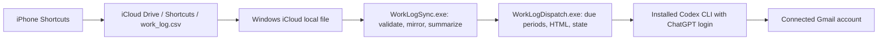

# Paulatim

Track actual and effective time on an iPhone, synchronize through iCloud, and receive daily and weekly reports from a Windows computer.

Paulatim began as an IELTS study log. Its next input upgrade will support IELTS, Projects, Academic, and Career while preserving existing records. **The current reader still accepts the original four-column CSV. Category support is being designed and is not implemented.**

The repository is named [`worklog-sync`](https://github.com/zhishuo0406-coder/worklog-sync). Existing `WorkLogSync` directories, executable names, scheduled-task names, and email subjects remain unchanged for installation compatibility. Paulatim is the project name, not a change to the running installation.

## Status

| Capability | Current status |
| --- | --- |
| Validate and mirror a local iCloud CSV while preserving its original bytes | Implemented |
| Actual/effective minutes, task totals, daily totals, effective percentage | Implemented |
| Daily/weekly HTML reports with a complete CSV snapshot and attachment | Implemented |
| 08:00 Beijing scheduling and catch-up after Windows login | Implemented; late-login logic tested with a simulated clock |
| Email through the installed Codex CLI and an existing Gmail connection | Implemented; depends on account access, quota, network, and CLI compatibility |
| Locks, receipt state, retry limits, timeout, child-process cleanup | Implemented with known reliability gaps; see validation below |
| Category + Task input: IELTS / Projects / Academic / Career | Design in progress; no parser or iPhone shortcut upgrade deployed |
| Independent server-confirmed receipts, stronger recovery, health reporting, Windows CI | Planned |
| macOS support or delivery while the Windows computer is off | Planned; unavailable in the current implementation |

## Architecture



- **Synchronization:** `WorkLogSync.cs` reads the source without modifying it, validates records, and writes `work_log.csv`, `report-data.json`, and `sync-status.json` beside its executable. A file lock, SHA-256 comparisons, atomic replacement, and a previous CSV mirror protect local updates. Invalid sources do not replace the last valid mirror.
- **Reporting:** `WorkLogDispatch.cs` selects due periods, reruns synchronization, and checks hashes across the source, mirror, status, and raw snapshot. It builds HTML and a CSV attachment locally, then asks the Codex CLI to use the existing Gmail connection. A failed source refresh blocks sending the old mirror as a fresh snapshot.
- **Scheduling:** Windows Task Scheduler starts native Windows-subsystem executables directly without opening a terminal. Login and minute-level checks handle catch-up and retry. No due report means no model process. Tasks use the signed-in user's interactive session; they do not run before login.
- **State:** Local receipt keys identify daily and weekly periods. Damaged receipt state is rejected rather than cleared automatically. The worker is instructed to search sent mail and read messages before confirming delivery, but the controller currently trusts its structured result rather than independently checking Gmail.

There is no paid model API integration or API-key requirement. Email uses an existing ChatGPT login and Gmail connection; access and usage limits still apply. This version has no database, hosted backend, `.csproj`, or NuGet dependency.

## Current CSV contract

UTF-8 records have **exactly four fields**, in this order:

```csv
timestamp,task,actual_minutes,effective_minutes
2030-01-01 09:00,"IELTS listening, practice",30,20
2030-01-01 10:00,Example task,45,40
```

These examples are fictional. A header is optional: the first row of a headerless file is a record. Recognized headers use `timestamp` or `datetime` with the other names shown above, or the Chinese headers in the [existing guide](WorkLogSync/README.md).

- Timestamps use `yyyy-MM-dd HH:mm`, `yyyy-MM-dd HH:mm:ss`, or the corresponding `T` separator formats. They are interpreted as Beijing local time and have no timezone offset.
- `task` must contain text. CSV quoting supports commas, quotes, and embedded newlines.
- Actual/effective time is measured in **minutes**, including nonnegative decimals with a decimal point. Effective percentage is `effective / actual × 100`, rounded to one decimal place; zero actual time produces no percentage.
- Duplicate rows, future dates, and effective time greater than actual time produce warnings and are retained, without silent correction or deduplication.
- The default source limit is 16 MiB. Empty, malformed, or oversized sources fail validation.

**Do not append Category with the current reader.** Five-column or mixed four/five-column input fails validation and can delay reports. The input upgrade requires a compatible reader and validation before changing the iPhone shortcut.

See the [proposed Shortcuts migration](docs/SHORTCUTS_MIGRATION.md) for compatibility rules, current-format probes, and the iPhone steps that require manual action. It is a proposal awaiting approval, not a deployed feature.

## Report schedule

The controller uses Beijing time (`Asia/Shanghai`, UTC+08:00):

- At 08:00 daily, report yesterday's calendar day.
- At 08:00 Sunday, also report the previous Sunday through Saturday.
- If the computer is off at 08:00, the next login starts catch-up once networking and the local source are ready. Delivery is not guaranteed at the instant of login.
- After several offline days, select only the **latest due daily period and latest due weekly period**, subject to configured first-report dates and existing receipts. Do not send every missed daily report.

The body and attachment include the complete validated CSV history, including rows outside the report period. A valid local iCloud file does not prove that the latest iPhone write has arrived on Windows.

## Run on Windows

### Requirements

Use 64-bit Windows, Windows PowerShell 5.1 or PowerShell 7, and the .NET Framework compiler/libraries at `%SystemRoot%\Microsoft.NET\Framework64\v4.0.30319`. For real input, install iCloud for Windows and make the source CSV locally readable. Task installers expect the Windows timezone `China Standard Time`.

Email additionally needs the installed Codex runtime, ChatGPT login, an authorized Gmail connection for the user's own mailbox, network access, and available quota. The code finds `codex.exe` under the current user's local `OpenAI\Codex\bin` directory; other layouts are not generally supported.

### Clone, build, and check safely

Clone into a separate development folder rather than an active installation directory:

```powershell
git clone https://github.com/zhishuo0406-coder/worklog-sync.git Paulatim
cd Paulatim
powershell.exe -NoProfile -ExecutionPolicy RemoteSigned -File .\WorkLogSync\Build.ps1
powershell.exe -NoProfile -ExecutionPolicy RemoteSigned -File .\WorkLogSync\Build-Mail.ps1
powershell.exe -NoProfile -ExecutionPolicy RemoteSigned -File .\WorkLogSync\Test-WorkLogSync.ps1
powershell.exe -NoProfile -ExecutionPolicy RemoteSigned -File .\WorkLogSync\Test-Mail.ps1 -Offline
```

These tests use synthetic data, without sending mail or registering tasks. Process-level execution policy does not change the persistent system policy. In Windows Codex, open the clone and read [HANDOFF.md](WorkLogSync/HANDOFF.md) and the [independent audit](docs/REVIEW-2026-10-11.md) before changing or deploying it.

Reproduce the independent audit from the clone root:

```powershell
powershell.exe -NoProfile -ExecutionPolicy RemoteSigned -File .\tools\Review-Offline.ps1
```

It builds into `_audit/` and uses synthetic fixtures only. **Its current expected exit code is 1:** three independent checks expose unresolved findings. It is not an all-green release gate.

### Configure a new installation

After building, replace both placeholders with the existing local iCloud CSV path and your own Gmail address:

```powershell
powershell.exe -NoProfile -ExecutionPolicy RemoteSigned -File .\WorkLogSync\Configure.ps1 -SourceCsv 'C:\PATH\TO\work_log.csv' -Recipient 'REPLACE_WITH_YOUR_GMAIL_ADDRESS'
.\WorkLogSync\WorkLogSync.exe
```

`Configure.ps1` creates local `config.json` and `mail-config.json`, refuses to overwrite existing configuration, and leaves email disabled. Inspect `sync-status.json` and `report-data.json` in `WorkLogSync/`. First-report dates control the earliest eligible daily date and weekly Saturday; the script derives them from the chosen first date.

For an explicitly authorized end-to-end check, `WorkLogDispatch.exe --verification` sends a **real email with the full source CSV**, even while normal email is disabled. It is not an offline test. Review the known findings before enabling email or replacing a working installation.

After authorized verification, enable email in the local configuration and run the installers from the clone root:

```powershell
powershell.exe -NoProfile -ExecutionPolicy RemoteSigned -File .\WorkLogSync\Install-LocalSync.ps1
powershell.exe -NoProfile -ExecutionPolicy RemoteSigned -File .\WorkLogSync\Install-Mail.ps1
```

The mail installer starts its task immediately. Installing/updating tasks is deployment. Existing tasks are not silently replaced by default; do not use `-UpdateExisting` without inspecting ownership and preserving configuration, records, and receipts. The current sync installer can leave an old task disabled if its initial check fails; it is not a complete rollback mechanism.

### Local status and privacy

Inspect `sync-status.json` and `mail-status.json`. `idle`, `waiting_network`, `waiting_source`, and `waiting_retry` describe normal waits; `attention_required` and `failed` need inspection. Do not delete `mail-state.json` to force retries: that removes receipt history used to prevent repeats.

Real configuration, credentials, CSV records, receipt state, outbox snapshots, logs, executables, and `_audit/` are excluded from Git. Only the explicitly fictional sample CSV is included. Outbox has no retention limit and contains full snapshots; keep it private. A public repository does not authorize publishing personal records.

Windows files do not automatically become available in every GPT chat. A chat needs its own authorized mail-access capability to read a report, which represents the last delivered snapshot.

## Validation and known limitations

The independent review on **2026-10-11** rebuilt both programs and reran **54 original offline checks: 54 passed**. Eleven additional checks produced **8 passes and 3 findings**:

1. Recipient validation accepts a trailing newline through the controller's direct configuration path.
2. Receipt-ID validation accepts a trailing newline.
3. A syntactically valid synthetic message ID can be recorded as sent without independent server evidence.

These remain unresolved. State, locks, and worker instructions reduce duplicate attempts but do not guarantee that mail is never missed or repeated. Static findings also concern retry timing, task/worker timeout mismatch, pending-request recovery, installer rollback, and outbox growth.

Late-login and weekly catch-up used a simulated clock, not a shutdown across 08:00. The independent review did not send real mail or verify a live iPhone-to-iCloud update. Historical reports describe earlier runs and do not replace new-account validation. See the [audit](docs/REVIEW-2026-10-11.md), [independent results](docs/independent-results.json), and [original delivery report](WorkLogSync/TEST_REPORT.md).

## Development roadmap

| Priority | Work | Status |
| --- | --- | --- |
| P0 | Trusted mail receipts and offline fault tests for send/crash/partial-success recovery | Planned; highest reliability priority |
| P1 | Strict field validation, consistent timeouts, durable retry requests and backoff | Planned |
| P1 | Backward-compatible Category + Task input and a user-edited iPhone shortcut | Design in progress; approval required before processing changes |
| P1 | Safe upgrade/rollback, health visibility, outbox retention, minimal Windows offline CI | Planned |
| P2 | Separate statistics/report logic from Windows adapters; evaluate macOS support | Planned; current implementation is Windows-only |
| P2 | Codex path/version and proxy compatibility | Planned |

[PRIORITIES.md](docs/PRIORITIES.md) contains existing reliability estimates, maintenance costs, and acceptance criteria; the input upgrade will need its own approved plan. [DEVELOPMENT_ROADMAP.md](WorkLogSync/DEVELOPMENT_ROADMAP.md) preserves earlier recommendations, some now historical: the public GitHub upload is complete. Documentation updates do not deploy runtime changes. Important decisions are recorded in [DECISIONS.md](docs/DECISIONS.md).

## Repository map

| Path | Purpose |
| --- | --- |
| `WorkLogSync/WorkLogSync.cs` | Validation, mirror, statistics |
| `WorkLogSync/WorkLogDispatch.cs` | Due periods, HTML/MIME, CLI worker, local state |
| `WorkLogSync/Build*.ps1`, `WorkLogSync/Configure.ps1`, `WorkLogSync/Install*.ps1` | Build, configuration, deployment |
| `WorkLogSync/Test*.ps1`, `tools/Review-Offline.ps1` | Regression tests and independent audit |
| `WorkLogSync/*.example.json`, `WorkLogSync/mail-result-schema.json` | Templates and worker result contract |
| `WorkLogSync/examples/`, `WorkLogSync/verification/` | Fictional input and historical sanitized results |
| `docs/` | Audit, priorities, decisions, migration records |

Git clones contain source, not binaries. `WorkLogSync/MANIFEST.sha256` describes the original delivery archive, including its binaries; it is provenance, not a checksum list for a newly built clone.

## 中文补充

Paulatim 通过 iPhone 记录、iCloud 同步、Windows 统计及邮件复盘形成流程。现有格式仍为「时间、事项、实际分钟、有效分钟」；Category 扩展尚未上线。先验证兼容解析，再调整 iPhone 快捷指令，保留旧数据、原路径和防重发状态。当前独立审查有三项待处理问题；本次 README 更新不部署程序、不修改任务、不发送邮件。
