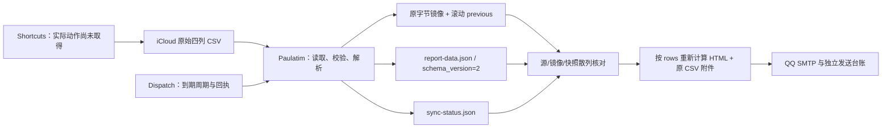

# Paulatim 长期数据兼容性审计与设计提案

审计日期：2026-10-12，北京时间。审计基线：`ab6c9d003195415109c1ce62e00f28ce425328e2`。

状态：**仅审计与提案，等待设计确认；没有实现迁移，没有修改运行代码、真实历史、生产配置、计划任务或 Shortcuts，也没有发送邮件。** 新增的审计脚本只构建隔离程序、读写合成夹具。

## 结论

现有程序具备严格四列校验、原始字节镜像、源文件只读、单文件原子替换和邮件周期防重发；**尚不具备长期数据架构要求的稳定记录身份、历史归档、版本迁移或整组数据事务回滚**。不能把 JSON 的 `schema_version=2`、位置编号 `record_number`、滚动 `.previous` 或邮件回执当成这些能力。

建议先建立“原始输入归档 → 有稳定身份的规范数据 → 兼容视图/统计/报告”三层。当前保持 CSV 输入；规范数据先用本地版本化 JSONL 文件与清单，不引入数据库。字段升级走显式版本迁移，SQLite 后续仅替换存储适配器。

**关键限制：没有 ID 的旧 CSV，在任意重排、编辑和相同内容的重复行之间，无法自动恢复唯一真实身份。** 设计应保留不确定性并阻止自动合并，不能承诺仅凭内容哈希解决此问题。

## 1. 已审计的实际流程



### 输入与写入边界

- `timestamp,task,actual_minutes,effective_minutes`，按位置恰好四列。首条可为四种已知表头之一，也可直接是数据；无表头不能丢第一条。
- 时间接受四种分钟/秒格式，不接受时区偏移；读端按北京时间解释。没有记录开始/完成含义，也没有记录原时间精度。
- 非空 Task、非负十进制分钟；引号、逗号、嵌入换行由 `TextFieldParser` 处理。Task 文本不修剪；时间与数字在解析时修剪。
- CSV 不包含显式版本、永久 ID、Category。新列、改列顺序或改成未知表头会失败。文件上限 16 MiB。
- 代码没有手机写入器。现有文档描述追加至 `iCloud Drive/Shortcuts/work_log.csv`，但没有实际 `.shortcut` 导出或完整动作步骤。因此**不能核实**追加/覆盖、失败重试、时区、数字格式、连续写入是否会重复；接收端契约已经确认。

### 读取、镜像与统计

- `Paulatim/Paulatim.cs:19` 的 Row 只有四个业务字段和 `record_number`。后者是本次解析的逻辑记录位置，包含表头占位，不是物理行号或永久 ID。
- `Parse`（129起）每次全量重新解析；同一条记录插入表头或重排后编号改变。缺失/新增/修改历史没有身份对账。
- 输出 `schema_version=2`（103、115行）分别描述报告/状态 JSON；未建立 CSV 或规范记录版本，也没有迁移注册表。SMTP 台账另有自己的 `schema_version=1`，不能混用。
- 重复判断比较解析后四个原始字段字符串。相同字符串仅警告、仍计入；`30` 与 `30.0` 等业务等值写法不会被此判断识别。警告不是幂等导入机制。
- 时间归一化为带秒的文本；原输入只有分钟时补 `:00`，精度信息只能从 raw CSV 恢复。有效分钟大于实际、未来日期保留并警告，不自动修正。
- `AtomicBytes`（202起）在镜像变动时覆盖 `.previous`；报告、镜像、状态分别替换，缺少整组提交点。失败状态中的 `previous_copy_preserved=true` 不能被当成所有 I/O 故障下的事务证明。
- 只要新来源非空且合法，删减历史也会成为新的有效镜像；未检测缩短、记录删除或历史编辑。

### 报告与发送

- `PaulatimDispatch.cs:84` 按北京时间08:00选择到期日报与上周日至周六的周报。已有 `daily:日期` / `weekly:周六日期` 回执阻止重发。
- `Snapshot`（211起）启动同步并检查源、镜像、status、raw base64 的散列一致性；这保护快照一致性，不能证明新来源保留了全部历史。
- `BuildMail`（227起）直接使用固定字段的 rows 重新统计，未验证报告 schema version，也没有独立统计版本。审计对它的直接调用不是绕过整条生产发送链路的证明。
- 同步 JSON 的 `weekly` 是“今天前七天”窗口（`Paulatim.cs:109`），正式邮件使用周日—周六日历周。这是两个现有口径，迁移时不能把两者误当成同一基准。
- 全历史原 CSV 出现在正文与附件；邮件体积上限约20 MB，JSON与来源也有上限。长期增长可能停止同步/投递；现有代码拒绝超限，没有自动截断策略。分片/归档必须另行设计。
- 邮件台账解决发送身份，不解决数据记录身份。迁移不得改变回执键、重置回执、修改已冻结待发载荷，或以迁移验证名义触发真实发信。

## 2. 十项要求的覆盖情况

| 要求 | 当前情况 | 提案 |
| --- | --- | --- |
| 显式数据 Schema | 仅有输出 JSON 标记 | 输入、规范数据、报告、台账、存储分别明确版本 |
| 永久 record_id | 无；只有位置号 | 一次分配 UUID，永久登记，不随内容/位置改变 |
| 逐版本迁移 | 无 | 注册 `M1→2`、`M2→3` 等，不跳过步骤 |
| 不可覆盖原始备份 | 只有镜像/滚动备份 | 创建新归档对象、散列校验、清单和独立备份 |
| 缺失历史字段 | 无 Category；旧提案曾建议 IELTS 默认 | 默认 null，缺失原因明确，不猜历史分类 |
| 幂等和重复检测 | 精确字段警告；无导入台账 | 来源/快照/发生位置对账，ID冲突拒绝，疑似重复保留 |
| 前后验证及回滚 | 单文件原子替换、部分故障保护 | 整个 generation 验证后原子切换，保留前代 |
| Shortcuts/周报兼容 | 当前四列有效，扩列会失败 | 旧输入适配器和原周期兼容报告视图 |
| SQLite 扩展 | 无数据库 | 先文件实现，小型存储接口；未来事务导入验证 |
| Schema/统计版本分离 | 未分离；统计重复在两处实现 | `data_schema_version` 与命名 `statistics_version` 独立 |

## 3. 推荐文件架构（未实现）

```text
data/
  active.json                         # 唯一活动 generation 指针
  raw/<sha256>.bin                     # 原始字节，包含表头/BOM/换行
  captures/<capture_id>.json           # 来源、散列、采集时间、字节数、编码
  sources/<source_id>.json             # 稳定来源身份，路径仅作定位信息
  imports/<import_id>/identity-plan.json
  generations/<generation_id>/
    manifest.json                     # 版本、父代、文件清单和散列
    records.jsonl                     # 该代规范记录，decimal 存精确文本
    identity-map.jsonl                # 输入记录发生位置 → 永久 ID
    import-ledger.jsonl               # 已提交导入、版本和来源连续性
    migration-results.json            # 逐步校验结果、工具/迁移代码散列
    views/                            # 报告兼容视图，属于该 generation
  migration-runs/<run_id>/journal.json # 作业进度；不能单独证明已激活
```

这是一套完整快照型文件 generation 方案，适合当前规模，代价是额外磁盘空间。先不用事件溯源平台、长期双写或云数据库；后续体积增长时再评估分页/分片。所有文件均为私有运行数据，必须被 Git 忽略，不能复用 `docs/` 放实际映射或记录。

### 分开的版本

| 版本 | 管理内容 |
| --- | --- |
| `input_format` + `input_schema_version` | 如 `legacy_csv/1`、未来 `versioned_csv/2`。旧CSV的1是适配器登记，不假装文件里原本有版本 |
| `data_schema_version` | 规范记录字段、类型、null规则、迁移链；DS1起步，不沿用报告 JSON 的2 |
| `statistics_version` | 命名口径，如 `formal_calendar_v1`、`rolling_7d_v1`；周边界、时区、舍入和重复纳入规则 |
| `report_schema_version` | 报告消费契约；兼容旧 `report-data.json` 时继续保留旧 `schema_version=2` 语义 |
| `storage_format_version` | JSONL/清单布局；未来SQLite布局与data schema独立 |
| `identity_policy_version` / `migration_ledger_version` | 导入身份算法、台账布局；改变时不能重分配已有ID |

规范 generation 只包含一个已知 `data_schema_version`，不默许混合版本。新读端显式支持旧版本并走迁移；未知未来版本、链路缺口、重复版本声明都拒绝激活。增加字段也要记录新 Schema；仅增加显示字段可以只升级报告格式。修正统计口径不能假装是数据迁移。

### DS1/DS2 的示例规划

- DS1：四个现有业务字段的无损表示、永久ID、输入出处、时间精度/解释依据、缺失值规范；不是把 CSV 列号作为 ID。
- `M1→2`：增加可空 Category，旧记录全部 null，并记录 `category_missing_reason=not_collected`。新分类只来自明确采集或经用户确认的历史标注。
- `M2→3` 仅作将来迁移样例：若重命名字段，显式一对一映射；若旧名/新名同时出现且值冲突，拒绝迁移，不能选一个覆盖。
- 从当前视图删除字段时，原值仍保存在前代、原始归档及带来源版本的 `legacy_fields` 中；迁移不能仅靠“当前界面不显示”彻底丢弃事实。真正清除历史是单独的、明确授权的数据操作。

时间保留 `timestamp_input`、精度（minute/second）、北京时间解释依据（legacy reader policy），不把补出的00秒当成真实测量精度。旧记录不补造开始时间、完成时间、采集时间或时区观测。实际采集归档的时间可以写 `captured_at_utc`，不能当成事件发生时间。

分钟用精确十进制字符串表示，例如 `"30.0"`，运算走 decimal；原词法表示另留出处。禁止先转 double 再迁移；单位一直明确为 minute，不四舍五入历史数值。DS1的负数/空Task规则与现有有效输入一致；原始非法输入可归档，但不能跳过错误行后把剩余行当成完整成功。

## 4. 永久 ID 与重复的处理

建议 UUIDv4，一次生成后持久化；UUID格式依据 [RFC 9562](https://www.rfc-editor.org/rfc/rfc9562.html)。UUID不是事实时间，不从它推断历史活动发生时间。仍需唯一性约束和冲突检测，不能把随机碰撞概率小当成无需验证。

### 旧四列首次登记

1. 固定原始基线快照，登记独立 `source_id`。路径变化不生成新来源；若把复制文件再当新来源导入，应先确认它是副本还是独立日志。
2. 为基线的每个**数据记录发生位置**分配不同ID，并在只创建一次的 identity plan 中保存：`source_id`、原始快照SHA、数据序号、原始记录定位/字段散列、record_id。含嵌入换行的记录不能按物理行拆分。
3. 同样内容的两条旧记录得到两个ID，保留数量并标记疑似重复。无法得知它们是真实重复活动还是误写，不能自动删除。
4. 重跑同一登记/导入必须重用 identity plan。ID分配是准备阶段，不在 `M1→2` 等纯迁移函数里随机生成。失败、重启及dry-run计划重用同一份登记；首次计划不是已有历史事实，不代表自动激活。
5. identity map、source registry 和原始基线必须一起备份。失去映射时不能用当前可变文件内容重新生成不同ID并声称原身份已恢复。

### 继续接收旧 Shortcuts

- 原来源按同一记录序列追加时，只登记新增后缀；此前ID从映射复用。对原记录核对原始字段/词法与顺序；表头单独处理，规范数据序号不包含表头。
- 可明确允许表头加入/去除以及记录分隔符变化，但必须完整验证已登记的逻辑记录内容与次序未变，记录该输入变换；不能靠全文件行号或只比较总量。
- 中间插入、删除、重排、改值、无法证明是追加的变更：保留新原始快照，记录冲突，**不激活新规范数据**。报告不能将旧 generation 声称为最新；状态应明确需要核对。人工确认一对一映射后才能保留旧ID继续处理。
- 两条完全相同的旧记录重排不可观测，不能证明各自真实身份；基线发生位置是导入身份，不声称还原实体事件身份。新的带ID输入才能消除此类歧义。
- 相同完整快照只导入一次；相同历史前缀＋新增后缀只增加新发生记录。`(source_id, snapshot_sha)` 台账、原始记录到ID的映射和已导入边界共同防重。内容指纹只提示重复，不作为主键。

### 未来带 ID 输入

旧快捷指令继续写四列，路径不变。未来单独部署显式版本输入，例如另一文件 `work_log_v2.csv`，包括 `input_schema_version,record_id,timestamp,task,actual_minutes,effective_minutes,category` 的已登记完整契约；不要把未经声明的五/七列自动猜成已知版本。

ID在首次保存前生成，失败重试复用同一待写记录的ID；取消不写入。重放“同ID、同内容”是幂等无操作；“同ID、不同内容”是冲突，只有显式有版本和前置revision检查的编辑操作才可更新，并保留旧revision。不同ID但同内容是疑似重复，仍保留。

不让新旧快捷指令为同一次活动各写一份。已有历史没有ID，若未来输入文件包含迁移导出的同一历史，应附可验证的ID映射/导出清单；不能当成另一个新来源盲目全部再导入。

## 5. 原始备份、迁移与激活协议

### 不可覆盖备份

- 捕获原始字节到临时文件并Flush；SHA-256命名，创建归档目标使用CreateNew语义，**不覆盖**。同名已存在时读回验证散列/长度，相符复用，不符立即失败。
- 所有来源，包括解析失败的输入，在已批准的归档策略下都可保存；“已归档”与“已验证/已导入”状态分开。
- 归档清单登记捕获时间、来源身份、字节数、编码探测/原表头、散列及工具版本；同一原始文件可有多条捕获记录。原始文件不添加表头、不转换编码、不清洗换行。
- 只读属性不是不可篡改保证。应用层只创建、ACL限制常规写入/删除、独立位置备份和定期读回验证共同实现保护；管理员/磁盘故障仍可能破坏单机文件。严格WORM需独立不可变存储，不能声称本地readonly已满足它。
- 每次迁移前验证原始归档、identity registry、旧generation的完整备份可恢复。保留政策不能自动清除迁移所需基线；原始归档不按普通outbox临时文件清理。

### 逐版本 pipeline

迁移条目明确 `migration_id/from/to/tool_hash/preconditions/transform/validators`。处理顺序：识别已支持的输入 → 固定快照/归档 → 导入DS1及ID映射 → `M1→2` → `M2→3` → 每步验证 → 候选generation完整验证 → 激活。

- Transform只从已知版本产生下一已知版本，不读当前时钟补事实、不发信、不改来源、不更新生产配置。必须保留ID、出处、未被本步授权修改的字段和所有已知扩展/退役值。
- 已经处于目标版本时无操作；整个pipeline重跑结果在业务字段、ID集合、语义散列上完全相同。run_id等执行审计元数据可不同，不能用其变动否认或证明数据幂等。
- 同一个迁移ID的已发布转换代码不可悄悄替换；代码散列不同要拒绝复用原结果或发布新的修复迁移，保留旧迁移实现供旧数据重放。
- 未知版本、非法字段、null规则冲突、缺失映射、重复ID或输入归档损坏时失败，不跳过，不把错误行自动归零。

### 单一提交点与失败恢复

1. 授权实施后，先暂停并核对所有会写本地派生文件的入口，包含当前仍在使用的旧同步任务和新邮件程序。迁移与同步共用锁协议；读者/报告持有一个generation，不跨代读文件。
2. 捕获只读来源快照，记录SHA。Shortcuts仍可继续在iCloud追加；Windows锁不是云端写入锁。激活前如来源SHA变化，重新捕获增量并验证，不能直接标成最新。
3. 在新的私有generation目录构建记录、映射、导入台账、兼容视图、manifest；Flush并校验全部文件。作业状态由prepared到validated。
4. **最后只原子替换 `active.json` 指针**。同一本地卷内采用经过故障注入验证的写入/替换与恢复策略；不是将多次File.Replace描述为整组事务。指针包含generation、manifest散列和前代引用。
5. 重启以有效active指针与manifest为提交事实，journal可能落后；只journal写了committed而指针没切换时不能视为已提交。候选不完整不得进入读端。
6. 激活前任何失败，活动数据仍是旧代；恢复作业复用已归档输入/ID计划，保留失败证据。激活后的校验失败，只在前代兼容且没有新提交写入时切回前代；不得恢复旧mail-state或丢掉激活后新记录。
7. 激活后已收到新记录时，回滚需将这些ID/来源/记录无损重放到兼容代并验证，或保持当前代只读等待修复。不能用旧目录覆盖当前数据。回滚旧二进制也必须确认其能读当前schema；否则只能保留兼容读端。

成功/失败/重启各阶段都禁止自动发验证信或重发历史周报。数据迁移回滚与邮件外部副作用恢复是两个不同过程，不能用一个目录快照解决两者。

## 6. 迁移前后验证与统计保护

不能只比文件散列（格式迁移必然变）或只比总分钟（两条错误可能相互抵消）。必须按记录ID对账：

- 原始对象散列和字节数、manifest引用都可读且一致；归档对象不会被新generation覆盖。
- ID非空、格式合法、唯一；本次Schema迁移前后ID集合完全相同、每个ID恰好一个当前revision。新增导入另外核对预期新增ID；不得混成迁移增量。
- 每个ID对应未授权变动的Task、时间文本/精度/解释依据、精确实际/有效分钟、原始出处一致；旧缺失字段为null且缺失原因准确。
- 全部记录的数量、未知/已知分类数量、按日/Task/分类的数量和分钟、有效率均验证；null分钟不自动算零，非法分钟拒绝。Category=null显示“未分类”，计入原有总量。
- 时间/数值归一化写明规则；如果规范数据舍弃了旧词法表示，原始出处仍要能恢复。完整源记录到规范记录的映射可反查。
- 同一个 `statistics_version` 下旧、新实现对同一固定数据和固定周期得到相同结果；分别覆盖正式日历周、滚动七日、零实际分钟和现有舍入方式。禁止迁移顺便去重或改变有效率定义。
- 空周期仍显示没有已同步记录，不能推断没有工作。周报HTML保持转义、安全显示和旧字段读取兼容。
- 回执键/值不变，已发周期仍为已发；SMTP accepted/uncertain/prepared载荷与状态不被迁移修改。
- future字段、非法版本、同ID冲突、被修改的原始归档、磁盘满等全部阻止激活；用户能看到哪步失败、差异摘要和当前有效generation。

固定声明的canonical序列化规则（编码、字段顺序、decimal词法规则、null、按ID排序）生成语义散列，规则本身有版本；它补充逐记录对账，不替代原始字节散列。

## 7. Shortcuts、旧报告与 SQLite 扩展

### 兼容报告

读端先提供旧报告字段和旧表头/无表头适配器，默认统计口径不变。旧 JSON `schema_version=2` 是兼容输出，不是内部DS2。读端转换时不得只保留UI需要的四列而丢弃规范数据中的新字段。

单来源阶段继续保留完整原CSV字节附件。增加第二种输入后，不能把多个来源重写拼接的CSV冒充“原始快照”：需分别保留源附件/manifest，另提供明确标为派生的全历史规范导出。附件命名、报告说明和体积预算要做单独兼容验收，不能偷偷把全历史改成最近一周。

本阶段只设计该多来源协议，不改变现有邮件内容。历史报告的重现依据是数据generation、statistics_version、report_schema_version、范围及原冻结载荷；新口径的重算报告必须标识口径，发送另行授权，不自动覆盖旧邮件。

### 未来存储接口

建议最小边界：`InputReader`（原输入到已验证记录）、`RecordStore`（按generation读取/提交）、`Migration`（逐版本）、`Statistics`（具名口径）、`ReportRenderer`（兼容输出）。先文件实现，不提前引入通用ORM或服务总线。

未来SQLite迁移先在新数据库导入同一批永久ID、revision、出处及版本台账，在单一事务内构建，再独立读回与文件store对账后切换；旧store保留。SQLite事务的原子提交仍依赖其已支持的文件系统/配置条件，依据 [SQLite Atomic Commit](https://www.sqlite.org/atomiccommit.html)。

数据库使用 record_id 唯一约束，不能重新以自增rowid替代永久身份。分钟不使用REAL表达精确十进制；可先用TEXT保存规范decimal再由应用计算，固定单位精度经确认后才可用缩放整数。[SQLite浮点说明](https://www.sqlite.org/floatingpoint.html)解释二进制浮点近似。

执行 `integrity_check` 与独立 `foreign_key_check` 并做业务逐记录对账；前者不检查外键错误，见 [SQLite PRAGMA说明](https://www.sqlite.org/pragma.html#pragma_integrity_check)。SQLite不放在iCloud上供多端并发写；Shortcuts仍通过版本输入导入。CSV导入/导出只是适配器，无版本/ID的四列导出是兼容展示，不能作为永久身份恢复的唯一备份。

## 8. 实际复现与未来验收计划

执行 `powershell.exe -NoProfile -ExecutionPolicy RemoteSigned -File .\tools\Audit-DataCompatibility.ps1`。仅合成CSV、隔离编译、直接调用报告构造器；没有读取生产历史、调用SMTP、凭据、计划任务或Gmail。

本轮 **12/12 当前行为复现成功**。这不是“12项长期兼容能力通过”，其中多项是缺口：

| 探测 | 实际结果 |
| --- | --- |
| 四列无表头/字节一致 | 保留首条，源与镜像字节一致 |
| 数据身份/版本 | 只有输出schema=2，无record_id/统计版本 |
| 添加表头/重排 | 同一事项的record_number改变 |
| 相同记录 | 警告且保留两条 |
| `30`/`30.0` | 无精确字段重复警告，仍保留两条 |
| 五列 | 拒绝，上一有效镜像保留 |
| 三次更新 | `.previous`覆盖为第二代，不保留第一代 |
| 合法来源缩短 | 接受，镜像记录数减少，无删除警告 |
| 时间精度 | 分钟变`:00`，未保存精度字段 |
| 报告构造器未来标记 | 旧字段仍在时可构造，不检查版本 |
| 两种weekly边界 | 滚动七天与日历周各自按现有规则工作 |

审计探测将表头变化/重排分成两项，共12项。输出在 `_audit/data-compatibility-*/audit-results.json`，不发布真实或本地运行数据。

本轮仅包含探测名称、复现状态及通用结论的合成结果保存为 [data-compatibility-results.json](data-compatibility-results.json)，可与脚本输出比较；不包含CSV内容、身份映射或生产路径。

待确认后实施的验收矩阵：

| 组 | 必须验证的场景 |
| --- | --- |
| 老输入 | 有/无表头、中文、引号、逗号、嵌入换行、BOM/编码声明、CRLF/LF、首条记录、小数及分钟/秒精度；不在手机先升级格式 |
| 身份 | 首次登记重跑、追加/重复重放、同内容多次活动、表头切换、路径改名、复制来源、重排/编辑冲突、ID映射缺失、同ID异内容 |
| Schema | 逐级迁移、已有目标版本无操作、跨多版本完整链、未知/降级/缺口拒绝、字段新增null、重命名冲突、字段退役/扩展保留 |
| 幂等 | 已激活迁移二次运行无新增/重ID；失败恢复复用identity plan；相同导入快照及重复事件不新增；语义结果固定 |
| 原始归档 | CreateNew冲突、已有对象损坏、manifest损坏、独立备份恢复、源SHA变化/变短，坏输入归档与导入状态分离 |
| 故障恢复 | 在归档、ID计划、每步迁移、验证、Flush、指针替换前后注入崩溃；磁盘满/拒绝写/文件锁/断电模拟；重启不读半代 |
| 回滚 | 激活前失败、激活后无新增/有新增、旧二进制不兼容、回滚再迁移；原始对象/永久ID/邮件回执始终保留 |
| 统计报告 | 周日/周六、08:00前后、跨天、固定北京时间、零值/空周期、重复纳入、null分类、同Task跨分类、decimal精度/舍入；源码与邮件基准分别固定 |
| 大小与性能 | 接近来源/JSON/邮件上限、多年全历史；超限失败可解释且不截断；后续分片需全量ID对账 |
| SQLite（未来） | 事务故障恢复、唯一约束、外键/完整性、精确小数、文件→DB→完整导出逐记录一致；保留源store直至验收 |

这些迁移验收尚未实现，不能用本轮行为审计代替。原始54项离线回归、SMTP与发送迁移故障检查在实现后作为独立门禁继续保留；已知legacy Gmail/CLI回执信任问题也不会被数据升级自动解决。

## 9. 建议实施顺序与确认边界

1. **当前完成：**源码与契约审计、12项合成复现、本文设计和风险/验收矩阵。文档与审计脚本按已授权流程提交GitHub。
2. **确认设计后仅开发：**版本定义、原始归档、DS1、身份登记/增量对账、文件generation提交/恢复、离线验证。继续接受四列；不把Category功能混入第一步。
3. **再做兼容输出：**报告适配器、具名统计口径、固定周期基准；在隔离目录验证旧输入与新内部存储共存。
4. **生产迁移另行确认：**只读核对实际Shortcuts和来源历史，准备具体数据差异/备份恢复证据、冻结路径与任务清单；经确认才登记真实ID和激活规范数据。绝不改写源历史。
5. **随后独立审批字段/手机升级：**实现DS2 Category=null及显式新版输入，复制手机指令到测试文件，通过真实iCloud虚构数据验收后切换；不会自动推断历史IELTS。
6. **SQLite只保留扩展：**文件方案出现可测量的容量/查询/事务需求后再评估，不在本轮安装数据库。

建议确认的是：三层架构、分开版本、UUID一次登记、旧输入继续兼容、歧义变更阻止自动激活、历史Category=null、完整generation提交与保留式回滚。确认设计不等同于批准读取/迁移生产历史、改任务、改手机或真实发信。
